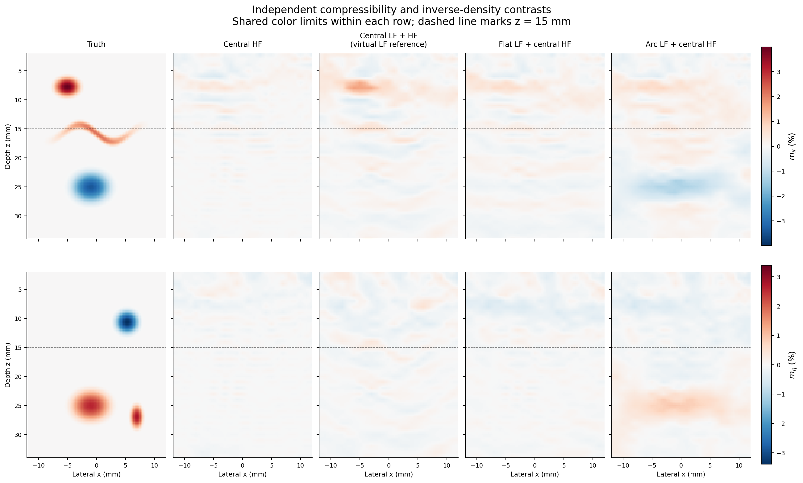

# 实际运行结果（2026-11-18）

这些结果来自本 PR 的实际 CPU 运行，默认弱对比度合成模体、40 dB 加性噪声、固定随机种子和共同正则化。所有四组使用相同真值；未按真值为每组单独调参。结果支持继续检查面内弧形侧阵的价值，但没有达到准确恢复复杂组织的程度。

## 快速预设：完整波场数据 → Born 反演

复现命令（在仓库根目录执行）：

```bash
python -m nsrno.theranostic --config experiments/theranostic_arc/quick.json --out out/theranostic_quick --replay-fullwave
```

| 场景 | 全 ROI κ RMSE（百分点） | 全 ROI η RMSE（百分点） | 深层 κ RMSE（百分点） | 深层 η RMSE（百分点） | 完整波场回放的留出相对误差 |
| --- | ---: | ---: | ---: | ---: | ---: |
| `central_hf` | 0.5479 | 0.4574 | 0.5822 | 0.4693 | 57.72% |
| `central_dual` | 0.5001 | 0.4558 | 0.5667 | 0.4779 | 50.45% |
| `flat_dual` | 0.5311 | 0.4512 | 0.5712 | 0.4696 | 41.97% |
| `arc_dual` | 0.4564 | 0.3894 | 0.4519 | 0.3583 | 23.79% |

κ、η 指相对背景的压缩率与逆密度对比度；RMSE 百分点 = `100 × RMS(m_reconstructed − m_truth)`。深层为 `z > 15 mm`。主表回波误差相对于无噪声留出散射数据，误差定义、含噪声版本及浅层/目标支持区域指标可查 [summary.json](summary.json) 和 [metrics.csv](metrics.csv)。不同几何的留出回波本身不同，不能把其归一化残差当成相同测试集上的唯一排名指标。



弧形侧阵主要改善了深层目标。浅层 κ-only、η-only 目标和弯曲薄带仍模糊，幅值偏低、参数串扰明显。全 ROI 的 κ/η 相对 L2 误差在弧形组仍为 **81.79% / 85.90%**；不能因为百分点 RMSE 数值小就认为恢复准确。大面积背景会降低全 ROI RMSE，必须同时查看目标区域及相对误差。

## 其他实际完成的运行

| 运行 | 波场节点数 | 两张图系数总数 | 实测墙钟时间 |
| --- | ---: | ---: | ---: |
| `quick_fullwave` | 46,990 | 1,650 | 13.6 s |
| `quick_grid_refine2` | 186,714 | 1,650 | 75.5 s |
| `quick_born_control` | 46,990 | 1,650 | 6.1 s |
| `study_fullwave` | 290,260 | 2,542 | 218.2 s |

环境：Python 3.12.14、NumPy 2.3.5、SciPy 1.17.0，CPU，BLAS 线程上限 1。部分运行与其他验证并行，时间仅供本次环境参考，不是统一硬件基准。每个运行的命令、配置及全部场景指标见 [validation.json](validation.json)。

将 quick 的波场间距从 0.35 mm 减至 0.175 mm，同时细化数据和逆算子后，弧形组全 ROI κ/η RMSE 为 **0.4584 / 0.3901 个百分点**，基础网格为 **0.4564 / 0.3894**，四组全 ROI 指标的排序相同。这个单次细化检查支持趋势在这两档网格间稳定，仍不能证明连续问题已充分收敛。

匹配 Born 对照中，弧形组 κ/η RMSE 为 **0.4251 / 0.3605 个百分点**，留出干净回波的 Born 预测误差为 **14.27%**。该模式的图像真值是基函数插值后的匹配真值，与 fullwave 的连续真值定义不同，不应直接把两种模式的 RMSE 差值全部归因于多次散射。

study 预设也已跑通；弧形组全 ROI κ/η 相对 L2 误差仍有 **86.83% / 88.06%**，中央双频组甚至劣于中央高频组。这说明增加频率和数据量没有自动解决问题。study 同时改变频率、阵元数量、波场网格和重建基函数，不能作为单独的频率消融。下一步应隔离这些变量，并研究表示误差、噪声权重和参数耦合。

## 数值检查与解释边界

- 14 项自动测试通过，包含解析 Green 函数网格收敛、互易性、κ/η 独立有限差分导数、实参数伴随、有界反演解析解、留出互易性安全及同频接收能力。
- quick 全部波场求解最大相对代数残差为 7.15e-14。这个数值不代表连续波动方程的离散误差。
- 所有已列场景通过独立的相对投影梯度 KKT 判据。LSMR 在部分运行中达到内迭代上限，原始 stop code、迭代次数及 KKT 值完整保存；没有只依赖 SciPy 的 success 标记。
- 另一个独立的小规模 `forward_refine=2` 检查中，池化端口数据与每个孔径单独求解的相对差异为 0，参考相减与多孔径索引一致；这检验实现，不构成真实介质验证。
- 示例采用面内侧阵、独立 LF 收发、自由流体中的有限线源、已知背景参考及无衰减二维声学。不能直接用于高程弯曲、侧阵只发射或阵元共同接线的真实探头。
- 这里的 LF/HF 频率是可运行的计算试验值，quick 的 HF 只有 0.35/0.45 MHz。真实探头频率、带宽和几何必须另行输入。

## 文件

- [geometry.png](geometry.png)：四组采集使用的几何与未知区域。
- [reconstruction.png](reconstruction.png)：共享色标的两张材料图。
- [sensitivity.png](sensitivity.png)：其他系数视为已知时的局部 2×2 信息，不能替代全局可辨识性分析。
- [summary.json](summary.json)、[metrics.csv](metrics.csv)、[wave_diagnostics.json](wave_diagnostics.json)：quick 的详细实测记录。
- [validation.json](validation.json)：其他运行的配置、命令和结果。

完整 NPZ 响应和材料图由运行命令写入 `--out`；为控制仓库体积，没有提交这些可重新生成的数组。示例在开发工作树上执行，quick 记录包含当时的源码哈希、版本与工作树状态；最终提交另含说明及格式修订。
