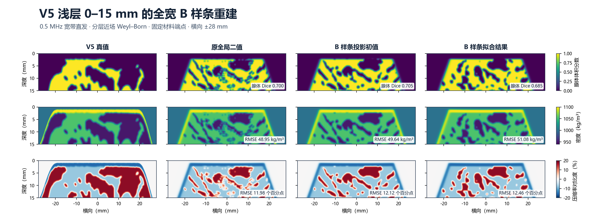

# V5 浅层 0–15 mm 的全宽 B 样条重建

沿用 L11-3A 的 0.5 MHz 宽带直发 k-Wave 数据、分层近场 Weyl–Born 算子和字典中心材料端点。横向 ±28 mm、深度 0–15 mm 用一个 16 × 50 的三次 B 样条控制点网格共同拟合。原全局二值标签的有符号距离场提供样条初值。15 mm 以深的组织参数固定，其散射贡献仍计入回波预测。用 15 个发射角拟合，留出 ±8° 和 ±24° 评估。

| 方法 | 腺体 Dice | 密度 RMSE（kg/m³） | 压缩率对比度 RMSE（百分点） | 留出角相对残差 |
|---|---:|---:|---:|---:|
| 原全局二值 | 0.700 | 48.95 | 11.98 | 69.68% |
| 样条投影初值 | 0.705 | 49.64 | 12.12 | 77.13% |
| 样条拟合后二值 | 0.685 | 51.08 | 12.46 | 62.25% |

留出角残差下降了 7.43 个百分点，两项浅层参数 RMSE 均上升。腺体 Dice 在 5–10 mm 从 0.677 升至 0.694，在 0–5 mm 从 0.771 降至 0.716。

[完整指标](shallow15_bspline_metrics.json) · [拟合记录](shallow15_bspline_summary.json)



## 在原实验环境复算

脚本默认从仓库的 `out/` 读取已有实验。用隔离检出时，将 `NSRNO_V5_RUN_ROOT` 指向已有的输出目录。反演入口沿用历史样条、基准反演和近场算子模块，输入包括历史采集、全波回波、固定分层参考和原全局二值结果。出图另需 V5 真值归档及历史全 FOV 样条结果。完整反演数组保存在服务器的 `out/v5_l11_3a_center05_layered_shallow15_bspline_20261117/shallow15_bspline_results.npz`。

```bash
export NSRNO_V5_RUN_ROOT=/home_nvme/zhuangyang/nsrno/out
run=experiments/v5_l11_3a_center05_layered_shallow15_bspline_20261117
python "$run/fit_shallow15_bspline.py" --device cuda:0
python "$run/report_shallow15_bspline.py"
```
